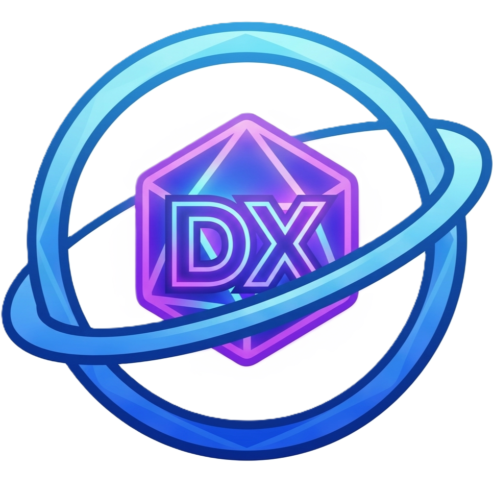

# Drix — Portable AI

<div  align="center">


</div>
<br>


> **Version:** `0.2.0-alpha` · **License:** MIT · **Status:** functional, in active development

Portable AI assistant: runs straight from an external HD/SSD, installing nothing on the host PC.
Embedded Ollama engine, lightweight web UI, terminal and headless modes, persistent memory,
agents, URL media downloads, and a local knowledge base (RAG).

---

## Table of contents

- [Compatibility](#compatibility)
- [Features](#features)
- [Quick start](#quick-start)
- [Documentation](#documentation)
- [Project structure](#project-structure)
- [Security](#security)
- [License](#license)

---

## Compatibility

| OS | Status | Notes |
|----|--------|-------|
| **Windows 10/11** | Full support | Launcher (`start.bat`), tray indicator, DPAPI secrets vault and embedded Ollama engine |
| **Linux** | Supported | Launcher (`start.sh`), web/terminal/headless modes, bundled or system Ollama, desktop indicator when a display is available; secrets use a `0600` local file instead of DPAPI |
| **macOS** | In development | Same code paths as Linux; not tested yet |

The core is platform-independent Python; the few platform differences (binary names,
venv layout, path expansion, secret protection) are isolated in `core/platform_paths.py`
and `core/python_runtime.py`.

## Features

| Area | What it does |
|------|-----------|
| Chat | SSE streaming, per-workspace history, attachments, light/dark theme |
| Models | Hardware-based selection, optimized switch, background preload |
| Agents | Tool calling with permissions, subagents (`coder`, `researcher`, `summarizer`) |
| Memory | SQLite + Chroma, background consolidation, context compaction |
| Web | Search/fetch with network policy and SSRF blocking, content treated as untrusted |
| Downloads | yt-dlp + portable ffmpeg: video/audio by URL, queue, progress and cancel |
| Knowledge | Local RAG in SQLite: upload PDF/DOCX/TXT/…, semantic search, sources cited in chat |
| Tools | Shell, files, memory, snapshots, MCP, skills (audio, image, video, vision) |

## Quick start

Requirements: Windows 10/11 or Linux, Python 3.10+ (3.10/3.11 recommended), ~30 GB free
on the external drive (Windows) or disk (Linux), a modern browser.

### Windows

```powershell
# 1. Plug in the external HD/SSD as F:
# 2. Run the launcher
F:\start.bat
```

> New machine? First set up the portable components (WinPython, Ollama, models) following
> [`docs/CREATION.md`](./docs/CREATION.md#setting-up-from-scratch).

### Linux

```bash
# 1. Clone or copy the project
git clone https://github.com/DougVikt/Drix_IA.git ~/Drix
cd ~/Drix

# 2. Create the virtualenv and install dependencies
#    If the scripts came from Windows/Git without the executable bit:
chmod +x start.sh scripts/install_linux.sh
./scripts/install_linux.sh

# 3. (Optional) Use the bundled Ollama binary or a system install
#    cp ollama ~/Drix/ia_system/engine/ollama && chmod +x ~/Drix/ia_system/engine/ollama
#    or: curl -fsSL https://ollama.com/install.sh | sh

# 4. Start Drix
./start.sh
```

The Linux launcher uses `.venv/bin/python` when it exists, sets `OLLAMA_MODELS` to
`ia_system/models`, and supports the same `web`, `terminal` and `headless` modes.
The desktop indicator needs a graphical session (`DISPLAY` or `WAYLAND_DISPLAY`) and
`python3-tk`; without a display Drix runs without the indicator.

To stop, use **Stop all** in the services panel (indicator). Never close the indicator window
with the X — closing is disabled on purpose to force a safe stop. In terminal/headless mode,
Ctrl+C (or SIGTERM) performs the same clean shutdown.

Quick check:

```powershell
Test-NetConnection 127.0.0.1 -Port 8000   # API/web
Test-NetConnection 127.0.0.1 -Port 11434  # Ollama
```

```bash
# Linux
ss -ltnp | grep -E ':(8000|11434)\b'
curl -s http://127.0.0.1:8000/ >/dev/null && echo "web OK"
```

## Documentation

Detailed guides live in [`docs/`](./docs), kept separate so the README stays short:

| Document | Use when you want to... |
|-----------|----------------------|
| [`docs/CREATION.md`](./docs/CREATION.md) | Understand how Drix is assembled, recreate the environment from scratch, folder structure and builds |
| [`docs/CONFIGURATION.md`](./docs/CONFIGURATION.md) | Configure everything: `config.yaml`, environment variables, API keys, permissions, network |
| [`RELEASE_NOTES.md`](./RELEASE_NOTES.md) | See what changed in this version |

## Project structure

```
F:\
├── api/            # FastAPI: auth, engine, REST routes
├── client/         # Drix client (terminal/API)
├── config/         # config.yaml (main configuration)
├── core/           # Core: agent, providers, tools, memory, downloader, knowledge...
├── data/           # Persistent data (conversations, memories, secrets, knowledge)
├── docs/           # User guides (creation and configuration)
├── ia_system/      # Portable Ollama + models + embedded Python
├── logs/           # drx.log / all.log
├── scripts/        # start.py, service.py, indicator.py, install_linux.sh, update_dump.py
├── skills/         # Installed skills
├── tests/          # Tests (unittest)
├── ui/             # Web interface (front) + web_app.py
├── workspace/      # Work area; downloads/ by default
├── .venv/          # Virtual environment
├── Makefile        # Cross-platform (Windows and Linux)
├── pyproject.toml  # Poetry · version 0.2.0-alpha
├── start.bat       # Windows launcher
└── start.sh        # Linux/macOS launcher
```

## Security

- API key auth + `HttpOnly`/`SameSite=Strict` cookie; CSRF by same origin.
- Rate limit (60 req/min general, 30 req/min chat); polling exempt.
- SSRF: private/loopback IP blocking and allowed-domains list.
- Secrets in `data/secrets.json` (DPAPI on Windows, `0600` local file with base64
  obfuscation on Linux/macOS) or env vars
  (`DRIX_SECURITY_API_KEY`, `DRIX_<PROVIDER>_API_KEY`, `OPENAI_API_KEY`, `ANTHROPIC_API_KEY`).
- Web content and knowledge snippets are treated as **untrusted** in prompts.
- Details in [`docs/CONFIGURATION.md`](./docs/CONFIGURATION.md#security-and-keys).

## License

MIT — see [`LICENSE`](./LICENSE).
