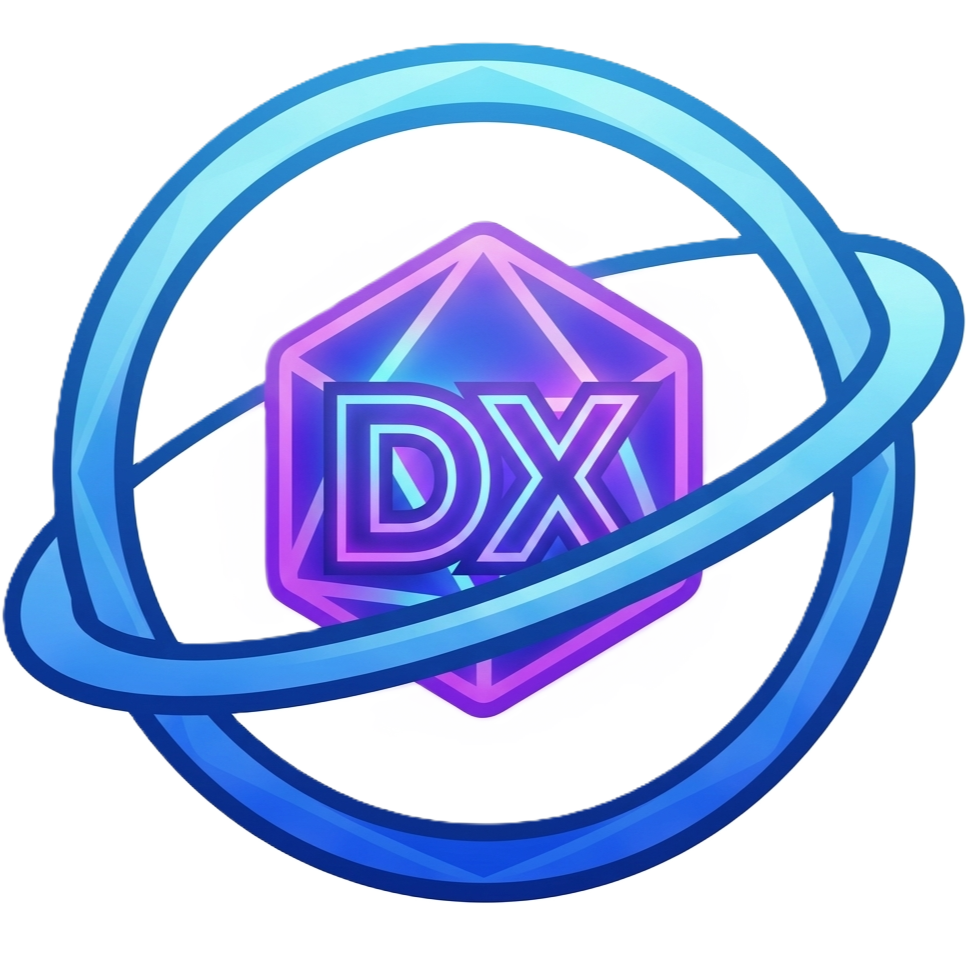

# docs

User guides for Drix.

- [`CREATION.md`](./CREATION.md) — how Drix is assembled and how to recreate the environment from scratch.
- [`CONFIGURATION.md`](./CONFIGURATION.md) — how to configure everything (config.yaml, env vars, keys).
- [`MAPS.md`](./MAPS.md) — offline maps: PMTiles/MapLibre, presets, downloads, chunked import and permissions.
